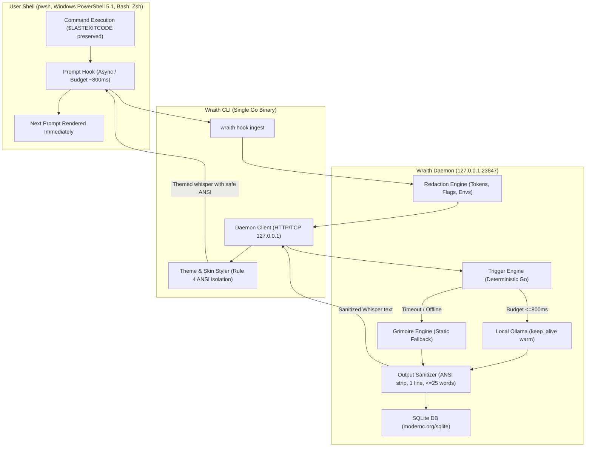

```
          .---.
         /     \
        | () () |     W R A I T H
         \  ^  /      The Haunted Terminal
          |||||       (runs 100% offline via Ollama)
          |||||
```

# 👻 WRAITH: The Haunted Terminal

> *"Four times you have summoned this error. It still refuses to leave."*

A single-binary Go CLI that gently "possesses" your shell. After commands, a ghost whispers one short, eerie, humorous line of commentary directly onto your terminal. Powered entirely by local open-weight models via Ollama.

**Theme:** Halloween / Día de los Muertos hackathon ("Ghost in the Machine")  
**Tone:** Spooky, dry, affectionate. Never cruel, never about the user's identity.  
**Core Promise:** Runs 100% locally on your laptop. Every whisper is free. Zero command text ever leaves your machine.

---

## 🎭 Persona Skin Gallery

Each persona has a fully customized visual skin configured as user-editable YAML data in `personas/`. Skins automatically degrade from TrueColor (24-bit) down to 256-color, 16-color ANSI, or plain ASCII markers if `NO_COLOR` or `--plain` is active.

| Persona | Marker | Prefix & Styling | Color Palette | Sample Whisper |
|---|:---:|---|---|---|
| **The Victorian Ghost** (`victorian_ghost`) | `🕯️` (`[*]`) | *Italic*, wrapped in matching quotation marks | **Lavender** (`#B39DDB`, 256: `183`, 16: `95`) | `🕯️ “Four times you have summoned this error; it still refuses to leave.”` |
| **Grumpy Dead Sysadmin** (`sysadmin`) | `👻` (`[sys]`) | `[root@beyond]` prefix, raw console cadence | **Phosphor Green** (`#00FF66`, 256: `48`, 16: `92`) | `👻 [root@beyond] That command just gave your filesystem a viking funeral. Hope backups exist.` |
| **Ghost of COBOL** (`cobol`) | `📟` (`[COBOL]`) | **Bold ALL CAPS**, mainframe columnar phrasing | **Amber** (`#FFB000`, 256: `214`, 16: `93`) | `📟 ABEND S0C4 IN PARAGRAPH-01. RE-READ 80-COLUMN SPECIFICATION BEFORE RETRYING.` |
| **Marigold** (`marigold`) | `🌼` (`[*]`) | *Italic*, tender & comforting phrasing | **Cempasúchil Orange** (`#FFA726`, 256: `215`, 16: `93`) | `🌼 Each stumble is only a petal laid upon the path of learning.` |

Switch persona at any time:
```bash
wraith persona sysadmin
```

---

## 🎨 Windows Terminal Color Scheme

Wraith comes with a matching **"Wraith Spectral"** color scheme tailored for Windows Terminal, featuring deep violet obsidian backgrounds (`#0F0E17`), ethereal text (`#E0DEF4`), phosphor greens, and lavender accents.

Run to display the ready-to-paste snippet:
```bash
wraith theme
```
Or find the raw JSON scheme ready for your `settings.json` at [docs/windows-terminal-scheme.json](file:///docs/windows-terminal-scheme.json).

---

## Architecture



---

## 60-Second Quickstart (PowerShell First)

### 1. Build Wraith
Using PowerShell:
```powershell
.\tasks.ps1 build
```
Or via Makefile:
```bash
make build
```

### 2. Run the Multi-Persona Demonstration
Watch all personas cycle in a themed replay montage with optional `--fx` ghost typing:
```powershell
.\bin\wraith.exe demo --persona all --fx
```

Or run in plain mode without color/emojis:
```powershell
.\bin\wraith.exe demo --persona all --plain
```

### 3. Install the Ghost Hook (`wraith haunt`)
Wraith is completely transparent. It displays an ASCII ghost banner and ceremony, previews the exact profile changes, and requests explicit confirmation:
```powershell
.\bin\wraith.exe haunt
```

Sample confirmation dialog:
```
          .---.
         /     \
        | () () |     W R A I T H
         \  ^  /      The Haunted Terminal
          |||||       (runs 100% offline via Ollama)
          |||||

=================================================================
👻 WRAITH PROFILE MODIFICATION PREVIEW (Opt-In Transparency)
=================================================================
Target Profile: C:\Users\...\Documents\WindowsPowerShell\Microsoft.PowerShell_profile.ps1

The following lines will be appended to your profile:
-----------------------------------------------------------------
# >>> WRAITH HOOK START >>>
function Invoke-WraithHook {
    $savedExit = $LASTEXITCODE
    ...
}
# <<< WRAITH HOOK END <<<
-----------------------------------------------------------------
🕯️  Awaken the specter within this shell parlor? [y/N]: y
```
*Note: A timestamped backup (`Microsoft.PowerShell_profile.ps1.wraith_bak_*`) is automatically created before any modification.*

### 4. Remove / Exorcise (`wraith exorcise`)
To remove Wraith cleanly with a quiet farewell:
```powershell
.\bin\wraith.exe exorcise
```

To purge all local SQLite memory:
```powershell
.\bin\wraith.exe purge
```

---

## The 7 Non-Negotiable Safety Rules

1. **Exit Status Preservation:** The prompt hook captures `$LASTEXITCODE`, `$?`, or `$status` and guarantees exact restoration. A failed command (`exit 42`) remains exit code 42.
2. **Read-Only Observation:** Wraith strictly observes command strings and exit codes. It never executes, intercepts, alters, or reruns commands.
3. **Prompt Budget Guarantee:** Hard deadline (default 800 ms, configurable). If Ollama times out or is slow, Wraith either falls back to an instant pre-written Grimoire whisper or stays silent.
4. **Output Sanitization & Fuzz Testing:** All LLM outputs are stripped of ANSI color escapes, OSC title injections, and control bytes. Strictly enforces at most 1 line and 25 words. Fuzz-tested with over 45,000 randomized VT100 exploit vectors. **Hard styling boundary:** ANSI colors and skins are applied strictly by Wraith AFTER model output is sanitized.
5. **Prompt Injection Boundary:** Command text is treated as untrusted data and quarantined inside `<user_shell_event>` boundary tags with defusal rules against break-outs.
6. **Zero-Leak Secret Redaction:** API keys (`sk-*`, `ghp_*`), passwords, auth flags (`--password`, `-p`, `--token`), and sensitive environment variables are sanitized before storage or LLM inference. High-risk commands skip haunting entirely.
7. **Transparent Opt-In:** Full diff preview and automated `.bak` backups before profile edits.

---

## Proof & Debug Overlay

Inspect what generated each whisper by running with `--debug`:
```powershell
.\bin\wraith.exe demo --debug
```
Whispers will display their provenance tag:
- `🕯️ “Four times you have summoned this error; it still refuses to leave.” (gemma3:4b, 420ms)`
- `🕯️ “Cobwebs and dust welcome you back to this long-forsaken chamber.” (grimoire)`

---

## Why Open-Weight Local Models?

- **100% Offline & Private:** Zero command text, file paths, or error messages ever leave your laptop.
- **Zero Cost Per Whisper:** Inference is executed locally via Ollama. No credit cards, API quotas, or metered billing.
- **Swappable Model Sizes:** Run `gemma3:1b` on battery power, `gemma3:4b` for balanced wit, or `gemma3:12b` on workstation hardware.
- **Editable Personas & Skins:** Personas and visual themes are simple YAML files. Anyone can add or modify ghost skins without recompiling Go code.

---

## Honest Limitations

- **Latency Budget:** On ultra-low-power machines or under heavy CPU load, local models may miss the 800ms budget. When this happens, Wraith transparently serves a Grimoire fallback.
- **Small Model Nuance:** Models under 3B parameters can occasionally generate dry or generic responses.
- **PowerShell Execution Policy:** On fresh Windows systems, running profile scripts may require `Set-ExecutionPolicy -Scope CurrentUser RemoteSigned`.
