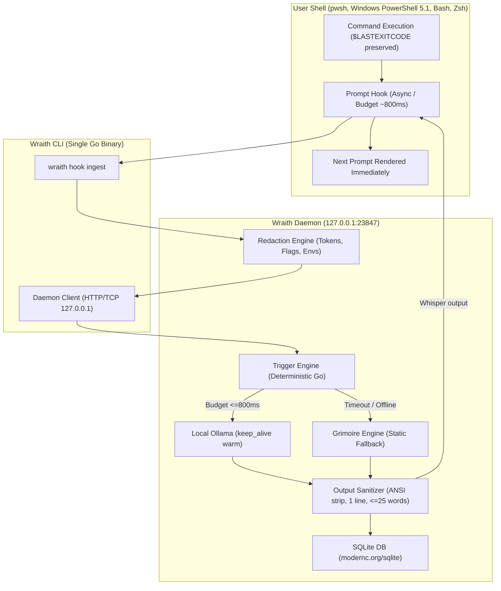

# 👻 WRAITH: The Haunted Terminal

> *"Four times you have summoned this error. It still refuses to leave."*

A single-binary Go CLI that gently "possesses" your shell. After commands, a ghost whispers one short, eerie, humorous line of commentary directly onto your terminal. Powered entirely by local open-weight models via Ollama.

**Theme:** Halloween / Día de los Muertos hackathon ("Ghost in the Machine")  
**Tone:** Spooky, dry, affectionate. Never cruel, never about the user's identity.  
**Core Promise:** Runs 100% locally on your laptop. Every whisper is free. Zero command text ever leaves your machine.

---

## Architecture



---

## 60-Second Quickstart (PowerShell First)

### 1. Build Wraith
Using PowerShell:
```powershell
.\tasks.ps1 build
```
Or via Makefile:
```bash
make build
```

### 2. Ensure Ollama is Running
Pull your preferred local model (default is `gemma3:4b`):
```bash
ollama serve
ollama pull gemma3:4b
```
*(Also supports `gemma3:1b` and `gemma3:12b` via config).*

### 3. Install the Ghost Hook (`wraith haunt`)
Wraith is completely transparent. It previews the exact profile code and requests confirmation before modifying anything:
```powershell
.\bin\wraith.exe haunt
```

Sample confirmation dialog:
```
=================================================================
👻 WRAITH PROFILE MODIFICATION PREVIEW (Opt-In Transparency)
=================================================================
Target Profile: C:\Users\...\Documents\WindowsPowerShell\Microsoft.PowerShell_profile.ps1

The following lines will be appended to your profile:
-----------------------------------------------------------------
# >>> WRAITH HOOK START >>>
function Invoke-WraithHook {
    $savedExit = $LASTEXITCODE
    ...
}
# <<< WRAITH HOOK END <<<
-----------------------------------------------------------------
Do you want to proceed with installing Wraith into your profile? [y/N]: y
```
*Note: A timestamped backup (`Microsoft.PowerShell_profile.ps1.wraith_bak_*`) is automatically created before any modification.*

### 4. Remove / Exorcise (`wraith exorcise`)
To remove Wraith cleanly without leaving traces:
```powershell
.\bin\wraith.exe exorcise
```

To purge all local SQLite memory:
```powershell
.\bin\wraith.exe purge
```

---

## The 7 Non-Negotiable Safety Rules

1. **Exit Status Preservation:** The prompt hook captures `$LASTEXITCODE`, `$?`, or `$status` and guarantees exact restoration. A failed command (`exit 42`) remains exit code 42.
2. **Read-Only Observation:** Wraith strictly observes command strings and exit codes. It never executes, intercepts, alters, or reruns commands.
3. **Prompt Budget Guarantee:** Hard deadline (default 800 ms, configurable). If Ollama times out or is slow, Wraith either falls back to an instant pre-written Grimoire whisper or stays silent.
4. **Output Sanitization & Fuzz Testing:** All LLM outputs are stripped of ANSI color escapes, OSC title injections, and control bytes. Strictly enforces at most 1 line and 25 words. Fuzz-tested with over 45,000 randomized VT100 exploit vectors.
5. **Prompt Injection Boundary:** Command text is treated as untrusted data and quarantined inside `<user_shell_event>` boundary tags with defusal rules against break-outs.
6. **Zero-Leak Secret Redaction:** API keys (`sk-*`, `ghp_*`), passwords, auth flags (`--password`, `-p`, `--token`), and sensitive environment variables are sanitized before storage or LLM inference. High-risk commands skip haunting entirely.
7. **Transparent Opt-In:** Full diff preview and automated `.bak` backups before profile edits.

---

## Ghost Personas

Four distinct identities ship out of the box in `personas/`:
- **Victorian Ghost (`victorian_ghost`):** Aristocratic 19th-century spirit. Refers to the computer as "the apparatus" or "the calculating engine."
- **Grumpy Dead Sysadmin (`sysadmin`):** Perished in a raised-floor server room in 1997. Speaks in curt, dry observations about inodes, DNS, and unmaintained crontabs.
- **Ghost of COBOL (`cobol`):** Undead mid-century mainframe soul. Disciplined, procedural, remembers punchcards.
- **Marigold (`marigold`):** Día de los Muertos guardian. Poetic, warm, scatters cempasúchil petals across compiler errors.

Switch personas on the fly:
```bash
wraith persona sysadmin
```

---

## Proof & Debug Overlay

Inspect what generated each whisper by running with `WRAITH_DEBUG=1` or in demo mode:
```powershell
.\bin\wraith.exe demo --debug
```
Whispers will display their provenance tag:
- `👻 Four times you have summoned this error; it still refuses to leave. (gemma3:4b, 420ms)`
- `👻 Cobwebs and dust welcome you back to this long-forsaken chamber. (grimoire)`

---

## Why Open-Weight Local Models?

- **100% Offline & Private:** Zero command text, file paths, or error messages ever leave your laptop.
- **Zero Cost Per Whisper:** Inference is executed locally via Ollama. No credit cards, API quotas, or metered billing.
- **Swappable Model Sizes:** Run `gemma3:1b` on battery power, `gemma3:4b` for balanced wit, or `gemma3:12b` on workstation hardware.
- **Editable Personas:** Personas are simple YAML files. Anyone can add their own ghost without recompiling Go code.

---

## Honest Limitations

- **Latency Budget:** On ultra-low-power machines or under heavy CPU load, local models may miss the 800ms budget. When this happens, Wraith transparently serves a Grimoire fallback.
- **Small Model Nuance:** Models under 3B parameters can occasionally generate dry or generic responses.
- **PowerShell Execution Policy:** On fresh Windows systems, running profile scripts may require `Set-ExecutionPolicy -Scope CurrentUser RemoteSigned`.
