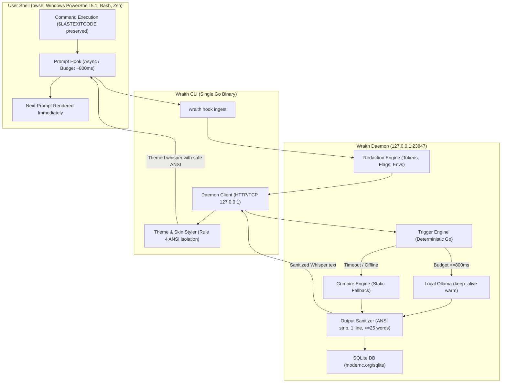

# Wraith Architecture & Design Rationale

This document details the engineering architecture of Wraith and the specific reasons behind each design choice.

---

## Component Design Rationale

### 1. Single Go Binary Architecture
* **Decision:** Implement all functionality (hook dispatcher, daemon, CLI management, LLM caller, SQLite store) in one statically-linked Go binary (`CGO_ENABLED=0`).
* **Rationale:** Zero external runtime dependencies. The user needs no Python runtime, Node.js installation, or C-compiler toolchain. Deployment is a single executable file.

### 2. Dual-Tier Process Model (Hook Dispatcher vs. Background Daemon)
* **Decision:** Shell hooks invoke a lightweight `wraith hook ingest` client that communicates with a local HTTP daemon running at `127.0.0.1:23847`.
* **Rationale:** Spawning a heavyweight runtime on every single terminal command adds tens of milliseconds of shell latency. The client simply delivers a payload over loopback TCP with an absolute prompt deadline. If the daemon is dormant, the hook auto-spawns it decoupled and exits cleanly.

### 3. Pure-Go SQLite (`modernc.org/sqlite`)
* **Decision:** Use pure Go SQLite without CGO.
* **Rationale:** Enables trivial cross-compilation across Windows, Linux, and macOS (x86_64 and ARM64) on GitHub Actions without installing cross-architecture gcc toolchains.

### 4. Deterministic Rule-Based Triggering Before LLM Call
* **Decision:** A deterministic Go engine (`internal/trigger/engine.go`) evaluates whether Wraith should speak before any inference occurs.
* **Rationale:** Calling an LLM after every single command would waste CPU/GPU cycles, drain laptop batteries, and become annoying. Triggers only fire on interesting events (repeated exit code failures, dangerous commands like `rm -rf`, late-night sessions, dormant directories, or probabilistic triggers).

### 5. Strict Prompt Budget & Static Grimoire Fallback (Rule 3)
* **Decision:** The client and server enforce a strict deadline (default 800 ms). If Ollama is slow, offline, or swapping model layers, Wraith immediately returns a persona-matched whisper from `internal/grimoire/grimoire.go`.
* **Rationale:** A user's shell must never feel sluggish or frozen waiting for an AI model. Shell interactivity is sacred.

### 6. Sanitization & Skin Isolation Boundary (Rule 4)
* **Decision:** Model output is sanitized (stripping ANSI, OSC escapes, quotes, newlines, and truncating to <= 25 words) **before** theme styling is applied.
* **Rationale:** LLMs can be tricked or hallucinate terminal control sequences. Isolating theme styling in the client guarantees that model output can never manipulate terminal state or inject escape sequences.

### 7. Standard OS User Data Locations
* **Decision:** Store databases and custom personas in standard OS user data locations:
  - Windows: `%LOCALAPPDATA%\wraith`
  - Linux: `$XDG_DATA_HOME/wraith` (or `~/.local/share/wraith`)
  - macOS: `~/Library/Application Support/wraith`
* **Rationale:** Keeps repositories and working directories clean. Avoids accidental check-ins of SQLite files or telemetry into user project trees.

